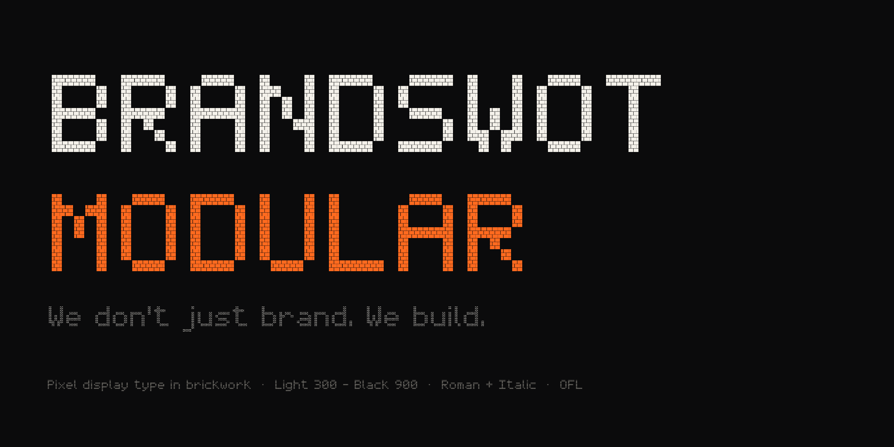
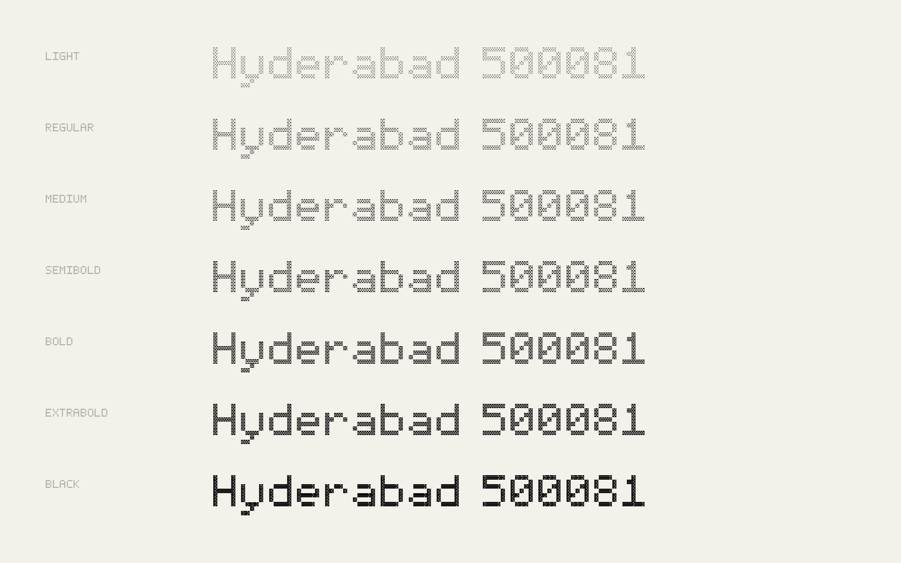
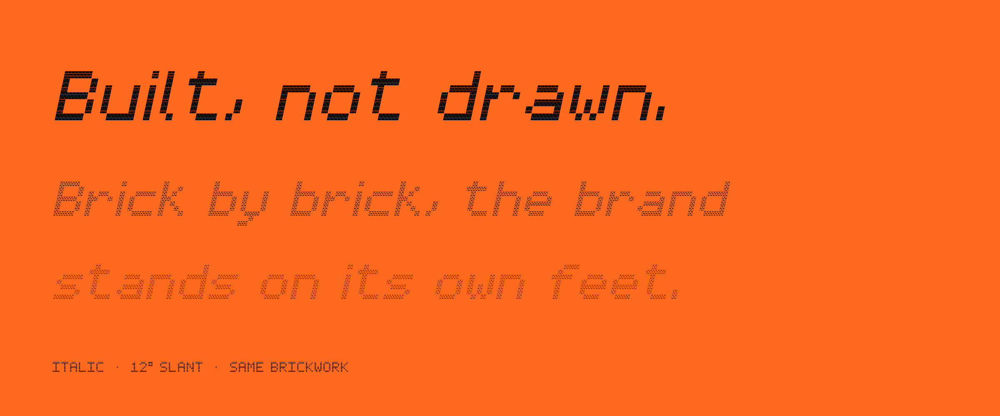
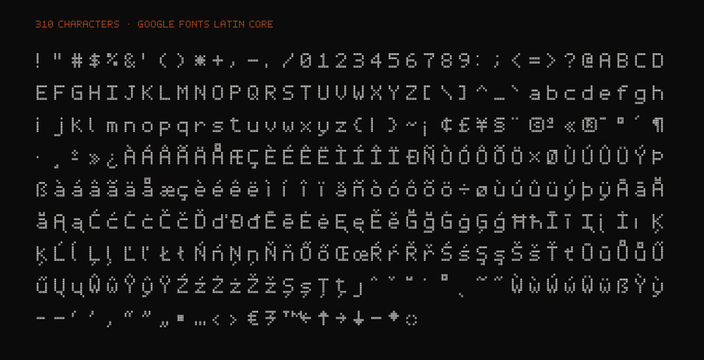

# BRANDSWOT Modular

A pixel display typeface built from brickwork. Every pixel of its 5 × 7 grid is laid in three courses of running-bond masonry, so the letters read as built, not drawn.

Designed by **Gowtham Sai** for **[BRANDSWOT Consultancy](https://brandswotconsultancy.com)**, Hyderabad, India. Free and open source under the [SIL Open Font License 1.1](OFL.txt).

**[Specimen & download →](https://cgowthamsai.github.io/brandswot-modular/)**



## Family

| | Roman | Italic |
|---|:-:|:-:|
| Light 300 | ✓ | ✓ |
| Regular 400 | ✓ | ✓ |
| Medium 500 | ✓ | ✓ |
| SemiBold 600 | ✓ | ✓ |
| Bold 700 | ✓ | ✓ |
| ExtraBold 800 | ✓ | ✓ |
| Black 900 | ✓ | ✓ |
| **Variable** `wght 300–900` | ✓ | ✓ |

Weight lives in the mortar: Light opens the joints, Black closes them. The letters never change shape.



## Character set

Google Fonts **Latin Core**: English and every Western, Central and Eastern European Latin language — French, German, Spanish, Portuguese, Polish, Czech, Turkish, Romanian, Hungarian and more. Indian Rupee **₹**, Euro, Pound, Yen, arrows, smart quotes, guillemets, © ® ™, combining accents with mark positioning.



## Use it

### Desktop
Download the latest zip from **[Releases](https://github.com/cgowthamsai/brandswot-modular/releases/latest)**, open `otf/`, select all, install.

### Web — CDN (no install)
```html
<link rel="stylesheet" href="https://cdn.jsdelivr.net/npm/brandswot-modular@2/css/brandswot-modular.css">
```
```css
h1 { font-family: "BRANDSWOT Modular", monospace; font-weight: 900; }
```

### Web — npm
```bash
npm install brandswot-modular
```
```js
import "brandswot-modular";            // Vite / webpack / Next.js
```

### Web — self-hosted
Copy `fonts/webfonts/BRANDSWOTModular[wght].woff2` and `BRANDSWOTModular-Italic[wght].woff2` to your site and use `css/brandswot-modular.css`.

### Tailwind
```js
// tailwind.config.js
theme: { extend: { fontFamily: { modular: ['"BRANDSWOT Modular"', 'monospace'] } } }
```

**Best above 32 px.** It is a display face: headlines, signage, packaging, motion titles, UI numerals.

## Licence

Free for personal and commercial use — logos, products, apps, print, broadcast. You may modify and redistribute it under the same licence. You may not sell the font files by themselves. Full terms: [OFL.txt](OFL.txt).

"BRANDSWOT" is a trademark of BRANDSWOT Consultancy.

## Build from source

Every letter lives in one readable file, [`sources/BRANDSWOTModular.pixels`](sources/BRANDSWOTModular.pixels): `#` is a pixel, `.` is empty. Edit, then:

```bash
pip install -r requirements.txt
make build      # pixel file → UFO masters → TTF, OTF, variable, WOFF2
make test       # FontBakery, Google Fonts profile
make zip        # desktop download
```

Requires Python 3.10+.

## Credits

Design: Gowtham Sai
Foundry: BRANDSWOT Consultancy — branding and growth consultancy, Hyderabad · Bengaluru
Custom type and brand work: [gowtham@brandswotconsultancy.com](mailto:gowtham@brandswotconsultancy.com)
